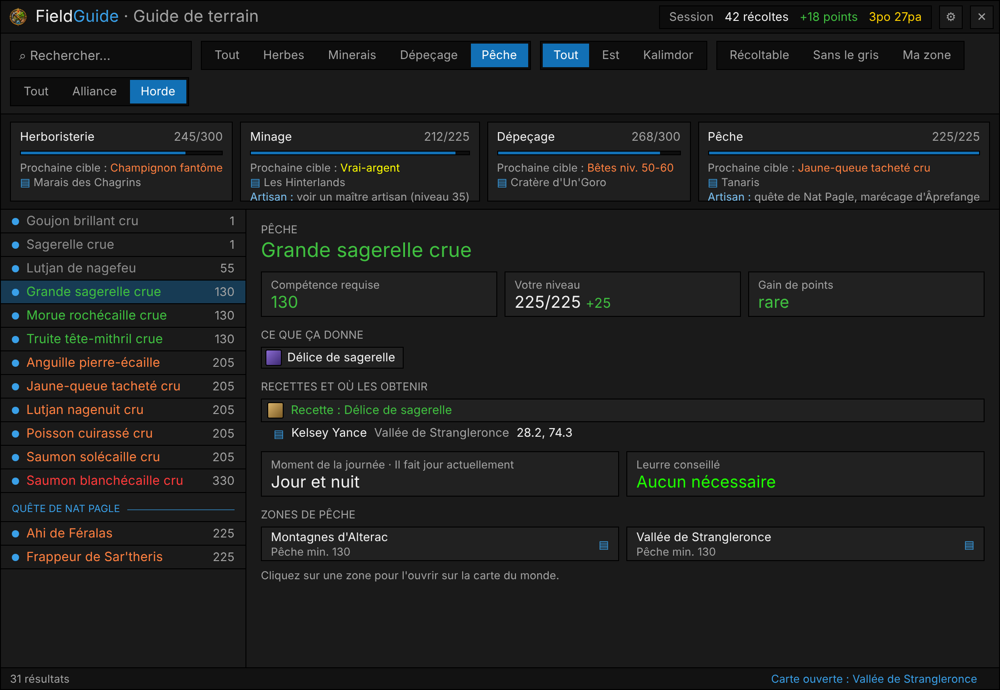
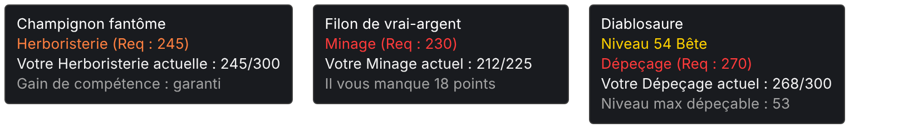
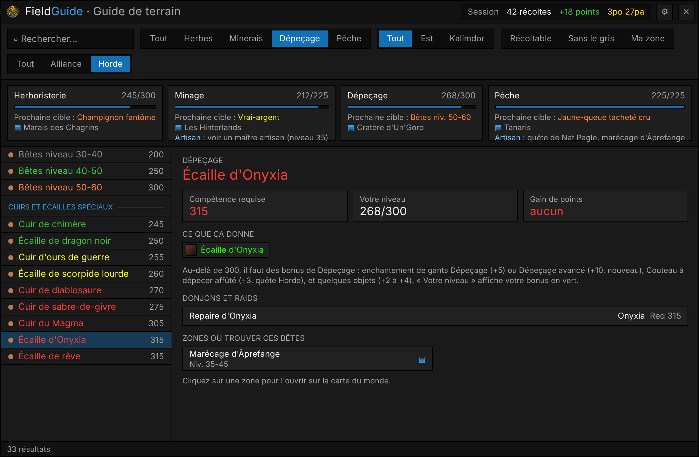
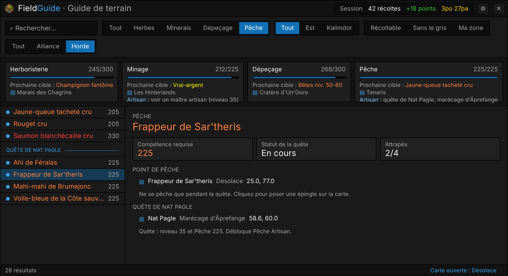

# FieldGuide

**Gathering field guide.** Skill requirements in tooltips, a searchable guide of every herb, ore, skin and fish with their zones, recipe vendors, progression and alerts for Herbalism, Mining, Skinning and Fishing.

[Français](#français) · [English](#english)

---

## Français

Addon autonome (sans dépendance) pour les quatre métiers de récolte : **Herboristerie**, **Minage**, **Dépeçage** et **Pêche**.

### Info-bulles

- Sur les herbes, les gisements et les monstres, la ligne de métier du jeu est complétée par la compétence requise, en couleur selon la difficulté : « Herboristerie (Req : 235) ». Pas de ligne en double.
- Votre niveau actuel, le gain de points ou les points manquants. Pour le dépeçage, le niveau maximum de bête que vous pouvez dépecer.
- Les bonus d'équipement comptent (canne et leurre, couteau, gants enchantés…).
- Mention « Composants nécessaires : » sur la ligne des composants dans les info-bulles de recettes.

### Fenêtre du guide

- Toutes les **herbes**, les **gisements**, les **tranches de bêtes** et les **poissons**, triés par niveau puis par ordre alphabétique, avec une recherche.
- **Filtres** : métier, continent (Est, Kalimdor), « Récoltable », « Sans le gris », « Ma zone », faction (Alliance, Horde). Ils sont gardés d'une session à l'autre, par personnage.
- **Fiche détaillée** : compétence requise, votre niveau, gain de points, ce que ça donne (herbes, minerais, pierres, gemmes, cuirs, plat cuisiné pour les poissons) et les zones où la trouver.
- **Recettes et où les obtenir** : tous les vendeurs, classés selon votre faction, avec leur position ; un clic pose un repère sur la carte.
- **Pêche** : moment de la journée, saison, leurre conseillé, et explication des zones à 330 (compétence 300 + bonus de canne et de leurre).
- **Cuirs et écailles spéciaux** : cuir de diablosaure, de sabre-de-givre, de chimère, écailles de dragon, carapaces silithides… ainsi que les dépeçages de raid au-delà de 300 (cuir du Magma, écaille d'Onyxia, écaille de rêve…), avec les bonus disponibles sur Forever.
- **Quête de Nat Pagle** : les quatre poissons de la quête Artisan avec leur point de pêche, le statut de la quête, les poissons déjà attrapés et une alerte en entrant dans la bonne zone.
- Fenêtre redimensionnable par l'angle, colonne de liste réglable à la souris, mise en page qui s'adapte à la largeur.

### Progression et alertes

- Pour chaque métier : **prochaine cible** conseillée et la zone où la trouver.
- **Rappel des paliers** : maître de votre capitale, livre de pêche Expert ou quête de Nat Pagle, cliquables pour poser une épingle sur la carte.
- **Alertes** : nouveau nœud récoltable, nœud passé en gris, outil manquant, palier suivant, poisson de quête dans la zone.
- **Session** : récoltes, points gagnés et valeur estimée (prix d'Auctionator s'il est installé, sinon prix marchand).

### Installation

1. Téléchargez `FieldGuide-x.y.z.zip` dans [Releases](../../releases).
2. Décompressez-le dans `Interface\AddOns` (par exemple `_forever_\Interface\AddOns`) : vous devez obtenir le dossier `AddOns\FieldGuide`.

### Utilisation

- `/fg` ou `/fieldguide` : ouvre ou ferme la fenêtre.
- `/fg options` : ouvre les options (info-bulles, alertes, minicarte, fenêtre, réinitialisation).
- `/fg reset` : remet les statistiques de session à zéro.
- Icône de la minicarte : **clic gauche** = fenêtre, **clic droit** = options, **glisser** = déplacer l'icône.

### Compatibilité

WoW Forever, Classic Era, TBC et Mists (Classic). Style inspiré d'ElvUI, et police d'ElvUI utilisée s'il est installé. Traduit dans les 11 langues officielles du jeu.

---

## English

Standalone addon (no dependency) for the four gathering professions: **Herbalism**, **Mining**, **Skinning** and **Fishing**.

### Tooltips

- On herbs, ore veins and creatures, the game's profession line gets the required skill, coloured by difficulty: "Herbalism (Req: 235)". No duplicate line.
- Your current skill, the skill gain or the missing points. For Skinning, the highest creature level you can skin.
- Equipment bonuses count (fishing pole and lure, knife, enchanted gloves…).
- "Reagents needed:" label on the reagent line of recipe tooltips.

### Guide window

- Every **herb**, **ore vein**, **creature level range** and **fish**, sorted by level then alphabetically, with a search box.
- **Filters**: profession, continent (East, Kalimdor), "Harvestable", "No grey", "My zone", faction (Alliance, Horde). They are kept between sessions, per character.
- **Detail panel**: required skill, your skill, skill gain, what it gives (herbs, ores, stones, gems, leather, cooked dish for fish) and the zones where to find it.
- **Recipes and where to get them**: every vendor, sorted by your faction, with their position; a click drops a pin on the map.
- **Fishing**: time of day, season, recommended lure, and an explanation of the 330 zones (skill 300 + pole and lure bonuses).
- **Special leathers and scales**: Devilsaur, Frostsaber and Chimera leather, dragonscales, silithid carapaces… plus the raid skins above 300 (Core Leather, Scale of Onyxia, Dreamscale…), with the bonuses available in Forever.
- **Nat Pagle quest**: the four fish of the Artisan quest with their fishing spot, the quest status, the fish already caught and an alert when you enter the right zone.
- Window resizable from its corner, list column width adjustable with the mouse, layout that adapts to the width.

### Progression and alerts

- For each profession: recommended **next target** and the zone where to find it.
- **Skill tier reminder**: the trainer in your capital, the Expert Fishing book or Nat Pagle's quest, clickable to drop a pin on the map.
- **Alerts**: new harvestable node, node turned grey, missing tool, next skill tier, quest fish in this zone.
- **Session**: gathers, skill points and estimated value (Auctionator prices when installed, vendor price otherwise).

### Installation

1. Download `FieldGuide-x.y.z.zip` from [Releases](../../releases).
2. Extract it into `Interface\AddOns` (for example `_forever_\Interface\AddOns`): you should get the folder `AddOns\FieldGuide`.

### Usage

- `/fg` or `/fieldguide`: open or close the window.
- `/fg options`: open the options (tooltips, alerts, minimap, window, reset).
- `/fg reset`: reset the session statistics.
- Minimap icon: **left click** = window, **right click** = options, **drag** = move the icon.

### Compatibility

WoW Forever, Classic Era, TBC and Mists (Classic). ElvUI-inspired style, and ElvUI's font is used when ElvUI is installed. Translated into the 11 official game languages.

---

## Credits

Built with the [Ace3](https://www.wowace.com/projects/ace3) libraries.

## License

[MIT](LICENSE)
